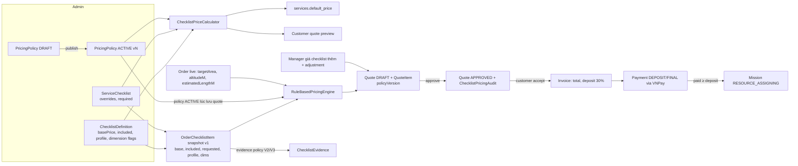
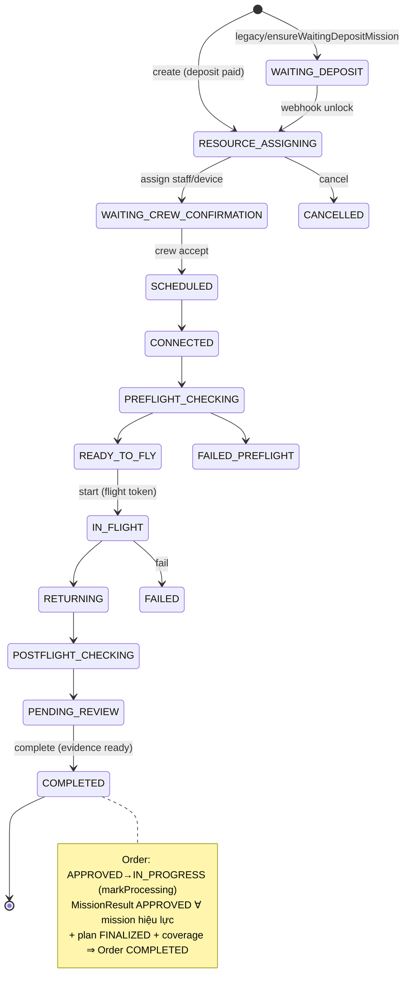

# MAIN FLOW — AS-IS ANALYSIS (On-Demand Monitoring System)

> Tài liệu chỉ đọc, mô tả **hiện trạng code** (không phải thiết kế mong muốn).
> Phạm vi: BE `on-demand-monitoring-system/ondemandmonitoring` và FE `ondemand-monitoring-web`, cùng branch `feat/order-multi-mission-refactor`
> (BE HEAD `f9d63caa`, FE HEAD `739c62f`; cả hai working tree sạch tại thời điểm phân tích).
> Không chạy test, không khởi động ứng dụng, không truy cập database. Mọi kết luận được truy tới implementation; chỗ nào chưa truy được ghi **CHƯA XÁC MINH**.
>
> Quy ước đường dẫn: `BE:` = `ondemandmonitoring/src/main/java/com/ondemandmonitoring/`, `FE:` = `ondemand-monitoring-web/src/`.
> Phân loại phát hiện: **CONFIRMED** (đã truy code), **POSSIBLE ISSUE** (có khả năng là lỗi, phụ thuộc ý định nghiệp vụ), **NOT VERIFIED**, **LEGACY** (còn code nhưng không còn đường gọi chính), **MISSING** (không có implementation).

---

## 1. Executive summary

1. **Luồng chính**: Customer chọn Service → chọn/thêm checklist + số ảnh/video → BE báo giá tạm (`POST /api/pricing/checklist-quote`) → tạo Order (`POST /api/orders`, trạng thái `PENDING`, chụp **snapshot giá checklist** vào `OrderChecklistItem`) → Manager review checklist khách thêm, readiness, flight area → Manager lưu Quote nháp (engine tính lại từ snapshot + policy ACTIVE) và duyệt Quote (Order `PENDING→APPROVED`) → Customer chấp nhận Quote → Invoice (cọc 30%) → thanh toán cọc VNPay → Manager lập Execution Plan, tạo N Mission, gán crew/drone, finalize plan → Staff bay, thực thi checklist, upload evidence, complete Mission → submit MissionResult → Manager duyệt → Order `COMPLETED` (khi đủ điều kiện coverage) → Delivery: preview → khách nghiệm thu → thanh toán cuối → giao bản gốc.
2. **Nguồn giá duy nhất về công thức** là `BE:pricing/service/ChecklistPriceCalculator.java`; Admin preview, customer quote, snapshot khi tạo Order và Quote của Manager đều gọi nó. Tham số giá đến từ `PricingPolicy` (versioned, ACTIVE) + `ChecklistDefinition`/`ServiceChecklist` override; tại thời điểm tạo Order các tham số catalog được **đóng băng** trong `OrderChecklistItem` (`pricingSnapshotVersion = 1`), nhưng **policy (tier/included rate) và context kích thước (diện tích/chiều dài/độ cao) không bị đóng băng** — giá thật chỉ cố định khi Manager lưu Quote (`Quote.pricingPolicyVersion`, `QuoteItem`) và được khóa hẳn khi Customer accept → Invoice.
3. **Giá Service hiển thị** = tổng giá các checklist mặc định ở mức included (lưu sẵn `services.default_price` qua `ServiceDefaultPriceService`); nếu tổng = 0 thì quay về `services.base_price` (LEGACY_BASE_PRICE).
4. **Checklist khách tự thêm** (CUSTOMER_CUSTOM) và **checklist catalog ngoài template** (CUSTOMER_SELECTED) luôn `managerQuoteRequired = true`; Manager phải nhập giá (`additionalUnitPrices`) cho mọi item `ADDITIONAL` không thuộc template, kể cả khi policy đã tính được giá.
5. **Order ↔ Mission là 1:N** (`Mission @ManyToOne Order`), điều phối bởi `ExecutionPlan` (DRAFT/FINALIZED + revision). `OrderExecutionCompletionPolicy.completeIfReady` là writer duy nhất của `Order.COMPLETED`.
6. **Rủi ro lớn nhất (xem §7)**: (a) preview báo "chờ Manager báo giá" cho checklist custom nhưng tạo Order lại fail-fast nếu policy thiếu rule custom; (b) Order `COMPLETED` trước khi khách nghiệm thu/thanh toán cuối; (c) coverage bắt buộc gán cả checklist REJECTED/DUPLICATE; (d) add-on "AI image analysis" 500.000đ hiển thị cho khách nhưng không bao giờ vào Quote; (e) context giá (diện tích/độ cao/chiều dài) đọc live từ Order, có thể đổi sau khi tạo; (f) Notification module rỗng.

---

## 2. Actors & roles (A)

| Actor | Enum | Nguồn | Quyền chính trong flow |
|---|---|---|---|
| Customer | `RoleCode.CUSTOMER` | `BE:user/...RoleCode` | xem service, báo giá, tạo/sửa Order, trả lời NEED_INFO, accept Quote, thanh toán, nghiệm thu delivery |
| Manager | `RoleCode.MANAGER` | | review Order, checklist, readiness, flight area; Quote; Execution Plan; tạo/gán Mission; duyệt MissionResult & media; release delivery |
| Admin | `RoleCode.ADMIN` | | catalog Service, Checklist, ServiceChecklist, PricingPolicy (draft/publish); cũng vào được Manager portal (`FE:app/router.tsx` `RoleRoute role={['MANAGER','ADMIN']}`) |
| Staff | `RoleCode.STAFF` | | được gán vào Mission với `MissionStaffRole` = `PILOT / OPERATOR / MAINTAINER / INSPECTOR` (`BE:mission/enums/MissionStaffRole.java`) |
| VNPay | — | `BE:finance/controller/VnPayWebhookController.java` | IPN/return → `PaymentWebhookProcessor` |
| System | — | `ApplicationRunner`s | `PricingPolicyInitializer` (seed/repair policy), `ServiceDefaultPriceBackfill` |

Authorization Mission (`BE:mission/service/impl/MissionAuthorizationServiceImpl.java`):
- `canViewMission`: MANAGER/ADMIN, hoặc STAFF được gán.
- `canExecuteMonitoringChecklist`: STAFF có assignment ACCEPTED hiện tại, ưu tiên OPERATOR, nếu không có thì PILOT; trạng thái IN_FLIGHT…COMPLETED.
- `canUploadMissionMedia`: STAFF có inspector-eligible assignment, Mission `PENDING_REVIEW` hoặc `COMPLETED`.
- `canCompleteMission` = Mission `PENDING_REVIEW` ∧ `canUploadMissionMedia`. **Lưu ý**: endpoint `POST /api/missions/{id}/complete` lại dùng `@PreAuthorize("@missionAuthorizationService.canUploadMissionMedia(#id)")` (không dùng `canCompleteMission`); kiểm tra trạng thái được dời vào `MissionService.completeMission`. (CONFIRMED, ảnh hưởng thấp).
- `canSubmitMissionResult`, `canAttachChecklistEvidence` (PENDING_REVIEW/COMPLETED, result chưa APPROVED/PENDING_MANAGER_APPROVAL).

FE điều hướng theo role: hash router `FE:app/router.tsx` → `#portal/customer/*` (`CustomerApp`), `#portal/manager/*` (`ManagerApp`, MANAGER|ADMIN), `#portal/admin/*` (`AdminApp`), `#portal/staff/*` (`DroneOperatorHomePage`), `#operator` (`OperatorDashboardPage`), `#payment/result|cancel` (`PaymentResultPage`). Guard chỉ ở client (`RoleRoute` đọc `authSession`); BE vẫn có `@PreAuthorize` riêng.

---

## 3. Service catalog & checklist configuration (B)

| Thực thể | File | Trường giá liên quan |
|---|---|---|
| `Service` | `BE:service/domain/Service.java` | `basePrice` (legacy), `defaultPrice` (cache hiển thị), `isActive` |
| `ChecklistDefinition` | `BE:checklist/domain/ChecklistDefinition.java` | `basePrice`, `includedImageCount`, `includedVideoCount`, `standardVideoDurationSeconds`, `pricingProfile`, `difficulty`, `area/length/altitudePricingEnabled`, `includedAreaHa/LengthKm/AltitudeM`, `isActive` |
| `ServiceChecklist` (template) | `BE:checklist/domain/ServiceChecklist.java` | `required`, `displayOrder`, `basePriceOverride`, `includedImage/VideoCountOverride`, `pricingProfileOverride` |
| `PricingPolicy` / `PricingRule` | `BE:pricing/domain/` | status DRAFT/ACTIVE/…, `policyVersion`, `effectiveFrom/To`, guardrails (`managerMaxDiscountPercent`, `managerMaxMarkupPercent`, `minimumPriceRatio`, `minimumPrice`, `highRiskDiscountPercent`); rule: `category`, `ruleKey`, `calculationType`, `fixedAmount`, `percentage`, `minValue/maxValue`, `unitSize`, `pricingProfile`, `mediaComponent`, `includedQuantity`, rounding |

Admin FE ↔ BE:

| Màn hình | FE | API |
|---|---|---|
| Catalog Service | `FE:features/admin/pages/Catalog` → `features/admin/api/catalogApi.ts` | `GET/POST/PUT /api/services`, `/api/services/{id}/image` |
| Checklist catalog | `FE:features/admin/pages/Checklists/ChecklistCatalogPage.tsx` → `checklistsApi.ts` | `/api/admin/checklists` |
| Gán checklist vào Service | `ServiceChecklistPage.tsx` | `/api/admin/services/{id}/checklists` |
| Preview giá Service | `FE:shared/api/checklistPricingApi.ts` | `POST /api/admin/pricing/service-preview`, `GET /api/admin/pricing/services/{id}/default-price` |
| Pricing policy | `FE:features/admin/pages/OperatingConfig/components/PricingPolicyTab.tsx` → `adminApi.ts` | `/api/admin/pricing-policies`, `/{id}`, `/{id}/publish` |

Seed/repair policy: `BE:pricing/config/PricingPolicyInitializer.java` — nếu chưa có ACTIVE thì tạo v1 (DISTANCE/AREA/… + MEDIA profile `DEFAULT` và `CUSTOM`); nếu ACTIVE thiếu MEDIA rule bắt buộc (gồm `GENERIC_CUSTOMER_ADDED` CHECKLIST_BASE/INCLUDED_IMAGE/EXTRA_IMAGE/EXTRA_VIDEO) thì **publish một version mới** (không sửa version cũ). Hệ quả: với DB khởi tạo bởi code hiện tại, policy ACTIVE thường có rule cho checklist custom → nhánh "pending manager quote" ở preview hiếm khi xảy ra, trừ khi Admin publish policy bỏ các rule đó.

Giá Service hiển thị: `BE:pricing/service/ServiceDefaultPriceService.java` tính lại `services.default_price` khi checklist/association thay đổi hoặc policy publish; `ServicePriceResolver.forDisplay` đọc giá lưu sẵn; `ServicePriceResolver.of(subtotal, legacy)` → `CHECKLISTS` (packageFee = 0) nếu subtotal > 0, ngược lại `LEGACY_BASE_PRICE`.

---

## 4. Pricing flow (C) — phần sâu nhất

### 4.1 Mười bước, theo thời gian

| # | Bước | Nơi xảy ra | Dữ liệu vào | Kết quả |
|---|---|---|---|---|
| 1 | Admin cấu hình checklist, template, policy | Admin pages → controllers checklist/pricing | — | `ChecklistDefinition`, `ServiceChecklist`, `PricingPolicy` DRAFT→publish ACTIVE |
| 2 | Tính giá hiển thị Service | `ServiceDefaultPriceService` / `ChecklistPricingPreviewService.defaultPrice` | checklist mặc định active, included allowance, không dimension | `services.default_price` |
| 3 | Customer xem danh sách service/giá | `GET /api/services`, `GET /api/services/pricing-estimate` (`ServiceController.estimatePricing`) | serviceId, `aiImageAnalysis` | `servicePrice = forDisplay(service).total`, + add-on AI (`odm.pricing.addons.ai-image-analysis`, mặc định 500000) |
| 4 | Customer chọn checklist & số ảnh/video | `FE:features/customer/lib/checklist/useOrderChecklist.ts` | template (`GET /api/services/{id}/checklists`), catalog (`GET /api/checklists/catalog`) | `quoteItems` |
| 5 | Báo giá theo lựa chọn (debounce 400ms) | `useChecklistQuote` → `POST /api/pricing/checklist-quote` → `ChecklistPricingPreviewService.customerQuote` | items + context `areaHa = π r²/10000`, `lengthKm`, `altitudeM` | `ServicePricePreviewResponse` (per-checklist lines, `total`, `quotePending`) |
| 6 | FE gộp hiển thị | `FE:features/customer/lib/checklist/selectionEstimate.ts` | estimate (B3) + quote (B5) | `servicePrice := quote.total`, `total := quote.total + addOns` |
| 7 | Tạo Order + snapshot | `POST /api/orders` → `OrderService.createOrder` → `OrderChecklistSnapshotService.capture` | payload (checklist, media count, area, altitude…) | `Order.PENDING`, `OrderChecklistItem` snapshot v1, `serviceBasePriceSnapshot` (=0 nếu service CHECKLISTS) |
| 8 | Manager review checklist khách thêm | `ManagerPricingPanel` → `PATCH /api/manager/orders/{id}/checklist-items/{itemId}` → `QuoteService.reviewChecklist` | ADDITIONAL / REJECTED(+note) / DUPLICATE | `OrderChecklistItem.reviewStatus` |
| 9 | Manager lưu Quote nháp | `PUT /api/manager/orders/{id}/quotes/draft` → `QuoteService.saveDraft` → `RuleBasedPricingEngine.calculate` | snapshot + policy ACTIVE **hiện tại** + context **live** của Order + `additionalUnitPrices` + `adjustmentAmount/Reason` | `Quote` DRAFT + `QuoteItem`s, `systemCalculatedPrice`/`managerQuotedPrice` per item |
| 10 | Duyệt → accept → Invoice | `POST …/quotes/{qid}/approve` (Manager), `POST /api/orders/{id}/quotes/{qid}/accept` (Customer) | — | Order `APPROVED`; Quote `ACCEPTED_BY_CUSTOMER`; `Invoice` ISSUED, `depositAmount = total × depositRate (0.30)` |

### 4.2 Công thức checklist (`ChecklistPriceCalculator.price`)

```
profile   = custom ? normalize(pricingProfile ?? "GENERIC_CUSTOMER_ADDED") : normalize(pricingProfile ?? "DEFAULT")
base      = custom ? MEDIA[profile].CHECKLIST_BASE (fallback profile "CUSTOM"; không có → CUSTOM_CHECKLIST_PRICING_NOT_CONFIGURED)
                   : catalogBasePrice (override ServiceChecklist → ChecklistDefinition.basePrice)
difficulty= includeDifficulty ? rule CHECKLIST key=difficulty : 0
requested = requested ?? included          (0..500, ngoài khoảng → INVALID_REQUEST)
included  = MEDIA[profile].INCLUDED_IMAGE.fixedAmount (+ INCLUDED_VIDEO)   chỉ khi allowance > 0
extra     = Σ tierLines(EXTRA_IMAGE, max(0, reqImg − inclImg)) + tierLines(EXTRA_VIDEO, max(0, reqVid − inclVid))
            tier: sort minValue, phải liên tục từ 0, block = round(qty/unitSize) theo CEILING|FLOOR|HALF_UP;
            thiếu tier → MEDIA_PRICING_NOT_CONFIGURED (409)
dimension = với mỗi AREA / DISTANCE("LENGTH") / ALTITUDE đang bật trên checklist:
            extra = max(0, context − includedX); rule FIXED|PER_UNIT|PER_BLOCK|TIERED_BLOCK
            thiếu rule → PRICING_RULE_NOT_FOUND; loại khác → PRICING_CALCULATION_FAILED
subtotal  = base + difficulty + included + extra + dimension   (scale 0, HALF_UP)
```

### 4.3 Công thức Order (`RuleBasedPricingEngine.calculate`)

```
PACKAGE        = order.serviceBasePriceSnapshot ?? service.basePrice   (luôn có dòng; = 0 với service CHECKLISTS)
RESOURCE       = CUSTOM_BASE một lần nếu có item custom snapshot v0 (legacy)
DISTANCE/AREA  = rule ranged order-level — CHỈ khi mọi item là v0 (list rỗng ⇒ true)
items v0       = rule CHECKLIST theo difficultySnapshot
items v1       = ChecklistPriceCalculator.price(snapshot, dimensions từ snapshot,
                 context = (polygonHectares(order.targetArea), order.estimatedLengthM/1000, order.altitudeM))
                 bỏ qua item REJECTED / DUPLICATE
OUTPUT         = theo resultFormats; HIGH_RESOLUTION_IMAGE; 4K_VIDEO
CONDITION      = theo priority (percent of subtotal)
PERMIT         = nếu permit REQUIRED
TERRAIN        = luôn FLAT
DISCOUNT       = rule DISCOUNT
MANUAL_QUOTE   rule → CUSTOM_WORK_PRICING_INCOMPLETE
systemCalculatedAmount = Σ lines
```

Quote (`QuoteService.saveDraft`):
```
cho mỗi item ADDITIONAL không phải SERVICE_TEMPLATE:
    managerQuotedPrice bắt buộc; ≠ systemCalculatedPrice ⇒ adjustmentReason ≥ 10 ký tự
adjustment = request.adjustmentAmount + Σ (managerQuotedPrice − systemPrice)
total      = systemCalculatedAmount + adjustment
guardrails : |discount| ≤ maxDiscount%, markup ≤ maxMarkup%, total ≥ max(system × minimumPriceRatio, minimumPrice), không 0
pricingApprovalStatus = NOT_REQUIRED (adjustment=0) | APPROVED (một Manager, không có bước duyệt thứ hai)
```

### 4.4 Pricing rule matrix

| Pricing element | Source of truth | Calculation location | Formula/rule | Snapshot field | Error/fallback | Evidence |
|---|---|---|---|---|---|---|
| Giá Service hiển thị | `services.default_price` (cache), `services.base_price` (legacy) | `ServiceDefaultPriceService`, `ServicePriceResolver.forDisplay/of` | Σ subtotal checklist mặc định ở included; =0 ⇒ basePrice | — | lỗi giá checklist ⇒ warning ở admin preview | `BE:pricing/service/ServicePriceResolver.java` |
| Package fee | `Service.basePrice` | `RuleBasedPricingEngine` | dòng PACKAGE | `Order.serviceBasePriceSnapshot` (0 nếu CHECKLISTS) | — | `OrderChecklistSnapshotService.capture`, engine |
| Base checklist (catalog) | `ServiceChecklist.basePriceOverride` → `ChecklistDefinition.basePrice` | `ChecklistPriceCalculator.price` | fixed | `OrderChecklistItem.basePriceSnapshot` | — | `ChecklistPricingPreviewService.input` |
| Base checklist (custom) | `PricingRule` MEDIA CHECKLIST_BASE profile `GENERIC_CUSTOMER_ADDED` (fallback `CUSTOM`) | `price()` | fixed | `pricingProfileSnapshot` (rule không snapshot) | thiếu ⇒ `CUSTOM_CHECKLIST_PRICING_NOT_CONFIGURED` (order) / `quotePending` (preview) | `ChecklistPriceCalculator.customBase` |
| Difficulty | rule CHECKLIST key=difficulty | `price()` khi `includeDifficulty` | fixed | `difficultySnapshot` | thiếu rule ⇒ 0/không dòng (CHƯA XÁC MINH chi tiết) | calculator |
| Included media | rule MEDIA INCLUDED_IMAGE/VIDEO | `price()` | fixedAmount khi allowance > 0 | `includedImage/VideoCountSnapshot` (số lượng; **giá không snapshot**) | — | calculator |
| Extra media | rule MEDIA EXTRA_IMAGE/VIDEO tiers | `price().tierLines` | Σ block × price theo tier | `requestedImage/VideoCount` | `MEDIA_PRICING_NOT_CONFIGURED` | calculator, `FlexibleChecklistPricingEngineTest.unpriceableExtraMediaFailsInsteadOfBeingFree` |
| Area/Length/Altitude per checklist | flags + included trên `ChecklistDefinition`; rule AREA/DISTANCE/ALTITUDE | `price()` dimension lines | max(0, context − included) × rule | `area/length/altitudePricingEnabledSnapshot`, `includedArea/Length/AltitudeSnapshot` | `PRICING_RULE_NOT_FOUND`, `PRICING_CALCULATION_FAILED` | calculator; context từ **Order live** |
| Distance/Area order-level | rule DISTANCE/AREA ranged | engine | chỉ khi mọi item v0 | — | — | engine dòng 52–58 |
| Output/format | rule OUTPUT | engine | theo resultFormats | — | — | engine |
| Condition/priority | rule CONDITION | engine | % subtotal | — | — | engine |
| Permit | rule PERMIT | engine | khi REQUIRED | — | — | engine |
| Terrain | rule TERRAIN | engine | luôn FLAT | — | — | engine (POSSIBLE ISSUE) |
| Discount | rule DISCOUNT | engine | — | `QuoteItem` DISCOUNT | — | engine |
| Giá Manager cho checklist khách thêm | input Manager | `QuoteService.applyManagerQuotes` | override per item | `managerQuotedPrice`, `systemCalculatedPrice`, `managerPriceAdjustmentReason` | `CUSTOM_WORK_PRICING_INCOMPLETE`, `PRICING_ADJUSTMENT_REASON_REQUIRED` | QuoteService |
| Manager adjustment | input Manager | `saveDraft` | + adjustmentAmount | `Quote.adjustmentAmount`, `QuoteItem` MANAGER_ADJUSTMENT | guardrails ⇒ risk flags / lỗi | QuoteService |
| AI image analysis add-on | `@Value odm.pricing.addons.ai-image-analysis` (500000) | `ServiceController.estimatePricing` | + cố định | **không có** | — | **không có consumer ở order/pricing/finance** (§7 H-2) |
| Deposit | `Invoice.depositRate` (0.30) | `QuoteService.accept` | total × rate | `Invoice.depositAmount` | — | QuoteService |

### 4.5 Thời điểm "đóng băng" giá

| Mốc | Cái gì cố định | Cái gì còn thay đổi |
|---|---|---|
| Customer quote (B5) | không gì | mọi thứ |
| Tạo Order (B7) | tham số catalog của từng checklist (base, included count, profile, flags/included dimension), số media yêu cầu, `serviceBasePriceSnapshot` | policy (giá included/extra/tier/dimension/custom base), context kích thước Order (customer sửa được khi PENDING/NEEDS_INFO/APPROVED qua `PATCH /api/orders/{id}`) |
| Lưu Quote nháp (B9) | `Quote.pricingPolicyId/Version`, `systemCalculatedAmount`, `QuoteItem` | lưu lại nháp sẽ tính lại với policy ACTIVE lúc đó |
| Approve Quote | Quote APPROVED; `ChecklistPricingAudit` | Customer sửa Order khi APPROVED ⇒ Quote bị supersede, Order về PENDING |
| Accept Quote | Quote ACCEPTED_BY_CUSTOMER, Invoice ISSUED (bất biến về số tiền) | — |

---

## 5. Order lifecycle (D)

`OrderStatus`: `PENDING, NEEDS_INFO, APPROVED, REJECTED, IN_PROGRESS, COMPLETED, CANCELLED`.

| Current state | Action/event | Actor | Preconditions | Next state | Side effects |
|---|---|---|---|---|---|
| — | `POST /api/orders` (`OrderService.createOrder`) | Customer | service active; checklist bắt buộc đủ; custom checklist định giá được (fail-fast) | PENDING | snapshot checklist; `reviewRecords.initialize`; `serviceBasePriceSnapshot` |
| PENDING | `POST /{id}/flight-area-review` | Manager | PENDING | PENDING | `flightAreaReviewStatus` |
| PENDING | `POST /{id}/approval` decision=NEED_INFO + reason | Manager | PENDING | NEEDS_INFO | lý do |
| PENDING | `POST /{id}/approval` decision=REJECTED | Manager | PENDING | REJECTED | — |
| NEEDS_INFO | `POST /{id}/additional-information` | Customer | NEEDS_INFO | PENDING | — |
| PENDING/NEEDS_INFO | `PATCH /{id}` | Customer | chưa accept quote | giữ nguyên | sửa thông tin (gồm altitudeM, estimatedLengthM) |
| APPROVED | `PATCH /{id}` | Customer | chưa accept quote | PENDING | Quote active ⇒ SUPERSEDED |
| PENDING | `POST /{id}/approve` (`OrderService.approveOrder`) | Manager | `flightAreaReviewStatus ∈ {PRELIMINARY_PASS, RESTRICTED}` | APPROVED | **không qua Quote/readiness** (§7 H-4) |
| PENDING | `POST /api/manager/orders/{id}/quotes/{qid}/approve` (`QuoteService.approve`) | Manager | Quote DRAFT, mọi item đã review, `OrderReadinessService.requireApprovable` | APPROVED | `ChecklistPricingAudit`; Quote APPROVED |
| APPROVED | Customer accept Quote | Customer | Quote APPROVED | APPROVED | Invoice ISSUED; `ensureWaitingDepositMission` |
| APPROVED | Mission COMPLETED → `DeliveryWorkflowServiceImpl.markProcessing → keepOrderInProgress` | System | — | IN_PROGRESS | Delivery PROCESSING |
| APPROVED/IN_PROGRESS | MissionResult approved → `OrderExecutionCompletionPolicy.completeIfReady` | Manager (gián tiếp) | plan FINALIZED; mọi mission hiệu lực COMPLETED + result APPROVED (không FAILED) + checklist final-ready + coverage | COMPLETED | Delivery READY_FOR_MANAGER_REVIEW |
| APPROVED/IN_PROGRESS | `POST /api/orders/{id}/execution-plan/amend` | Manager | lý do | giữ nguyên | plan DRAFT, revision+1 |
| * | Cancel Order | — | — | CANCELLED | **CHƯA XÁC MINH** endpoint hủy Order trực tiếp (không thấy trong `OrderController`) |

Quote: `DRAFT → APPROVED → ACCEPTED_BY_CUSTOMER`, nhánh `SUPERSEDED`; `PENDING_REVIEW` còn trong enum/truy vấn (LEGACY cho luồng duyệt 2 cấp đã bỏ — endpoint `decidePricingAdjustment` đã xóa, method còn).

Delivery (tách khỏi OrderStatus, `BE:delivery/service/impl/DeliveryWorkflowServiceImpl.java`):
`PROCESSING → READY_FOR_MANAGER_REVIEW → CUSTOMER_REVIEW (release-preview, cần completeIfReady) → REVISION_REQUESTED | FINAL_PAYMENT_PENDING (result/accept) → PAYMENT_CONFIRMED → READY_FOR_DELIVERY (confirmFinalPayment từ webhook) → DELIVERED (release-originals, cần Invoice PAID)`.

Invoice/Payment: Invoice `ISSUED → PARTIALLY_PAID → PAID` (tính lại từ Σ payment SUCCESS trong `PaymentWebhookProcessor`); Payment `PENDING/PROCESSING → SUCCESS | FAILED`, `CANCELLED/REFUNDED`. Thanh toán cuối chỉ tạo được khi `deliveryWorkflow.requireFinalPaymentEligible` (`PaymentPersistenceService.prepare`).

---

## 6. Order ↔ Mission 1:N, execution, evidence, finance (E–G)

### 6.1 Mission
- Tạo: `POST /api/missions/{orderId}` (`MissionController` → `MissionService.createMissionWithOutcome`): Order tồn tại, plan DRAFT, Order APPROVED (hoặc IN_PROGRESS khi đã amend), tiền cọc đã thanh toán; Mission bắt đầu đúng một giờ trước giờ khách mong muốn và kết thúc không muộn hơn giờ kết thúc mong muốn ⇒ `RESOURCE_ASSIGNING`.
- `MissionStatus`: `CREATED, WAITING_DEPOSIT, RESOURCE_ASSIGNING, WAITING_CREW_CONFIRMATION, WAITING_OPERATOR_ACCEPTANCE, SCHEDULED, CONNECTED, PREFLIGHT_CHECKING, READY_TO_FLY, FAILED_PREFLIGHT, PENDING_APPROVAL, IN_FLIGHT, IN_PROGRESS (legacy), RETURNING, POSTFLIGHT_CHECKING, PENDING_REVIEW, COMPLETED, FAILED, CANCELLED`.
- Gán: `assign-device`, `assign-staff` (RESOURCE_ASSIGNING/WAITING_CREW_CONFIRMATION) → crew `accept/reject` → `start` (flight token) → `return` → `postflight` → PENDING_REVIEW → `complete` (post-device check + `requireReadyForSubmission`) → COMPLETED (release resources, `ensureCompletedResult`, `markProcessing`). `fail` ⇒ FAILED.
- Deposit: `MissionPaymentEligibilityService` — đủ cọc ⇔ `paidAmount ≥ depositAmount`; webhook gọi `unlockIfEligible` cho mọi Mission của Order (WAITING_DEPOSIT → RESOURCE_ASSIGNING).

### 6.2 Execution plan & coverage
- `ExecutionPlanServiceImpl.finalize`: bắt buộc đã cọc, coverage ready, materialize `MissionChecklistExecution`, FINALIZED, gọi `completeIfReady`.
- `ExecutionPlanCoverageService`: mission hiệu lực = không CANCELLED và không có `cancellationAt`; coverage đếm **mọi** `OrderChecklistItem` (kể cả REJECTED/DUPLICATE).

### 6.3 Checklist execution & evidence
- `ChecklistExecutionStatus`: PENDING/IN_PROGRESS/COMPLETED/UNABLE_TO_VERIFY; `ChecklistAssessmentStatus`: NOT_ASSESSED/COMPLIANT/NON_COMPLIANT.
- Evidence policy theo snapshot: V3 khi checklist có media (ảnh ≥ minImage **và** video ≥ minVideo), V2 nếu không. `ChecklistEvidenceServiceImpl.v3Satisfied`; final approval yêu cầu mọi evidence eligible.
- FE: `FE:features/mission/api/checklistExecutionApi.ts`, `checklistEvidenceApi.ts`, `features/media/api/operatorMediaApi.ts` (`/missions/{id}/media-uploads`, `manual-media-uploads`).

### 6.4 MissionResult
- `MissionResultService.upsert` (Mission COMPLETED, `canSubmitMissionResult`) → Manager `approve` (`/api/manager/mission-results/{id}/approve` → `completeIfReady`, `markReadyForManagerReview`) / `reject`.
- Media approvals: `/api/manager/missions/{missionId}/media-approvals/{mediaId}/approve|reject`.

### 6.5 Notification
- **MISSING**: `BE:notification/service/NotificationService.java` là class rỗng (không annotation, không method); `NotificationController` (`/api/v1`) không có endpoint; không có module nào gọi `NotificationService`. FE có `NotificationsPage`, `customerMediaApi` `/api/customer/media-notifications` (thông báo media riêng, CHƯA XÁC MINH implementation BE).

---

## 7. Sơ đồ

### 7.1 Customer → Manager → Mission → Completion

```mermaid
flowchart TD
  A[Customer: Service list<br/>GET /api/services, /pricing-estimate] --> B[Chọn checklist & media<br/>useOrderChecklist]
  B --> C[POST /api/pricing/checklist-quote<br/>ChecklistPricingPreviewService.customerQuote]
  C --> D[POST /api/orders<br/>OrderService.createOrder + capture snapshot]
  D -->|PENDING| E{Manager review}
  E -->|NEED_INFO| F[NEEDS_INFO] -->|additional-information| E
  E -->|REJECTED| X[REJECTED]
  E --> G[Review checklist khách thêm<br/>PATCH checklist-items]
  G --> H[PUT quotes/draft<br/>RuleBasedPricingEngine]
  H --> I[POST quotes/approve<br/>readiness] -->|APPROVED| J[Customer accept quote<br/>Invoice ISSUED, deposit 30%]
  E -.->|POST /approve (đường thứ 2)| J0[APPROVED không Quote]
  J --> K[VNPay deposit → webhook<br/>unlock missions]
  K --> L[Execution plan DRAFT<br/>tạo N Mission, gán crew/drone]
  L --> M[finalize plan<br/>coverage + materialize]
  M --> N[Staff bay → checklist → evidence → complete]
  N -->|Mission COMPLETED| O[Order IN_PROGRESS<br/>Delivery PROCESSING]
  O --> P[MissionResult submit → Manager approve]
  P -->|completeIfReady| Q[Order COMPLETED]
  Q --> R[release-preview → CUSTOMER_REVIEW]
  R -->|revision| P
  R -->|accept| S[Final payment → PAID]
  S --> T[release-originals → DELIVERED]
```

### 7.2 Admin config → policy → quote → snapshot → mission/finance



### 7.3 Multi-Mission lifecycle


(Một số cạnh trung gian như WAITING_OPERATOR_ACCEPTANCE, PENDING_APPROVAL, retry/replace-drone: **CHƯA XÁC MINH** đầy đủ thứ tự.)

---

## 8. API & data mapping

| Business step | FE page/component | Method + endpoint | BE controller/service | Request/response DTO | Entity/table |
|---|---|---|---|---|---|
| Danh sách service | `customer/pages/CreateOrder` (`useCreateOrderMeta`) | GET `/api/services` | `ServiceController` / `ServicePriceResolver.forDisplay` | `ServiceResponse` (`defaultPrice`, `priceSource`) | `services` |
| Ước tính giá service | `PricingEstimateCard` | GET `/api/services/pricing-estimate?serviceId&aiImageAnalysis` | `ServiceController.estimatePricing` | `ServicePricingEstimateResponse` | `services` |
| Template checklist | `useOrderChecklist` | GET `/api/services/{id}/checklists`, GET `/api/checklists/catalog` | checklist controllers | — | `service_checklists`, `checklist_definitions` |
| Báo giá checklist | `useChecklistQuote` / `ChecklistQuoteCard` | POST `/api/pricing/checklist-quote` | `ChecklistPricingController` → `ChecklistPricingPreviewService.customerQuote` | `ChecklistPricingPreviewRequests.Customer` → `ServicePricePreviewResponse` | `pricing_policies`, `pricing_rules` |
| Tạo Order | `CreateOrderPage` / `CustomerCreateRequestPage` (`lib/createOrder/payload.ts`) | POST `/api/orders` | `OrderController` → `OrderService.createOrder`, `OrderChecklistSnapshotService.capture` | create order request (CHƯA XÁC MINH tên lớp) → `OrderResponse` | `orders`, `order_checklist_items` |
| Danh sách/chi tiết Order (KH) | `OrdersPage`, `OrderDetailPage` | GET `/api/orders/mine`, `/api/orders/{id}` | `OrderService` | `OrderResponse` | `orders` |
| Sửa Order | `OrderSectionEditor` | PATCH `/api/orders/{id}` | `OrderService.updateCustomerOrder` | — | `orders`, `quotes` |
| Bổ sung thông tin | `ReviewNotice` | POST `/api/orders/{id}/additional-information` | `OrderService.submitAdditionalInformation` | — | `orders` |
| Hàng đợi Manager | `QueuePage` | GET `/api/orders/pending`, `/approved` | `OrderService` | — | `orders` |
| Flight area / approval | `OrderReviewPage` (`manager/api/ordersApi.ts`) | POST `/api/orders/{id}/flight-area-review`, `/approval`, `/approve` | `OrderService` | — | `orders` |
| Readiness | `OrderReadinessCard` | GET/PUT `/api/manager/orders/{id}/readiness[/{code}]` | `ManagerReadinessController` / `OrderReadinessService` | — | review records |
| Pricing review | `ManagerPricingPanel` | GET `/api/manager/orders/{id}/pricing` | `ManagerPricingController` → `QuoteService.getPricingReview` | pricing review DTO | `order_checklist_items`, `quotes` |
| Review checklist | `ManagerPricingPanel` | PATCH `/api/manager/orders/{id}/checklist-items/{itemId}` | `QuoteService.reviewChecklist` | — | `order_checklist_items` |
| Lưu quote | `ManagerPricingPanel.saveDraft` | PUT `/api/manager/orders/{id}/quotes/draft` | `QuoteService.saveDraft` | `QuoteDraftRequest` (`additionalUnitPrices`, `adjustmentAmount`, `adjustmentReason`, `expectedPricingRevision`) | `quotes`, `quote_items` |
| Duyệt quote | `ManagerPricingPanel.approve` (saveDraft rồi approve) | POST `/api/manager/orders/{id}/quotes/{qid}/approve` | `QuoteService.approve` | — | `quotes`, `checklist_pricing_audits`, `orders` |
| Xem/accept quote | `CustomerFinancePanel` | GET `/api/orders/{id}/quote`; POST `/api/orders/{id}/quotes/{qid}/accept` | `CustomerFinanceController` → `QuoteService.accept` | `CustomerQuoteResponse` → `InvoiceResponse` | `quotes`, `invoices` |
| Thanh toán | `CustomerFinancePanel.pay` | POST `/api/invoices/{id}/payments/deposit` \| `/final` | `PaymentService` / `PaymentPersistenceService.prepare` | `PaymentResponse` (URL VNPay) | `payments` |
| Kết quả thanh toán | `PaymentResultPage` | GET/POST `/api/payments/by-reference/{ref}[/refresh]` | `PaymentService.refreshByReference` | `PaymentResponse` | `payments` |
| Webhook | — | VNPay IPN/return | `VnPayWebhookController` → `PaymentWebhookProcessor.process` | `VerifiedWebhook` | `payments`, `invoices`, `missions` |
| Execution plan | `OrderMissionPlanningSection`, `PlanningHeader` (`manager/api/planningApi.ts`) | GET `/api/orders/{id}/execution-plan`; POST `/finalize`, `/amend` | `ExecutionPlanController` / `ExecutionPlanServiceImpl` | `{expectedPlanRevision, decompositionConfirmed}` | `orders` (plan fields) |
| Tạo Mission | `CreateMissionPage`, `OrderResourceAssignmentWizard` | POST `/api/missions/{orderId}`; GET `/api/orders/{orderId}/missions` | `MissionController` / `OrderMissionController` → command service / query service | — | `missions` |
| Gán & vận hành | `MissionDetailPage`, `DispatchPage` (`manager/api/missionsApi.ts`) | POST `/api/missions/{id}/assign-device|assign-staff|accept|reject|start|return|postflight|complete|fail|cancel` | `MissionController` / `MissionService` | `MissionResponse` | `missions`, `mission_staff_assignments` |
| Checklist execution | Staff pages (`mission/api/checklistExecutionApi.ts`) | `/api/missions/{id}/checklist-executions…` | `MissionChecklistExecutionController` | — | `mission_checklist_executions` |
| Evidence/media | `operatorMediaApi`, `checklistEvidenceApi` | `/missions/{id}/media-uploads`, `/api/missions/{id}/…evidence` | media / `ChecklistEvidenceController` | — | media assets, evidence |
| Mission result | `mission/api/missionApi.ts`; Manager `missionsApi` | POST `/api/missions/{id}/result`; POST `/api/manager/mission-results/{id}/approve|reject` | `MissionResultController`, `ManagerMissionResultApprovalController` → `MissionResultService` | — | `mission_results` |
| Delivery (Manager) | `features/delivery/api.ts` | GET `/api/manager/orders/{id}/delivery`; POST `/release-preview`, `/release-originals` | Manager delivery controller → `DeliveryWorkflowServiceImpl` | — | `order_deliveries` |
| Delivery (Customer) | `CustomerDeliveryPanel` | GET `/api/orders/{id}/delivery`, `/deliverables[/preview]`; POST `/result/accept`, `/result/revision-request` | `CustomerDeliveryController` | — | `order_deliveries` |
| (FE gọi, BE không có) | `manager/api/ordersApi.ts`, `mediaApi.ts` | PUT `/api/orders/{id}/internal-note`, `/mission-brief`, POST `/api/orders/{id}/deliver` | **không có** (FE comment ghi "PROPOSED") | — | — |

---

## 9. State & ownership matrix

| Trường/trạng thái | Writer(s) | Reader chính | Ghi chú |
|---|---|---|---|
| `Order.status` | `OrderService` (create/approve/reject/needInfo/update), `QuoteService.approve`, `DeliveryWorkflowServiceImpl.keepOrderInProgress`, `OrderExecutionCompletionPolicy.completeIfReady` | mọi module | 4 writer; COMPLETED chỉ 1 writer |
| `Order.flightAreaReviewStatus` | `OrderService.reviewFlightArea` | `approveOrder` | không là điều kiện của `QuoteService.approve` (CHƯA XÁC MINH nếu readiness bao hàm) |
| `Order.executionPlanStatus/Revision` | `ExecutionPlanServiceImpl`, `MissionService.create` (revision++) | completion policy | |
| `OrderChecklistItem.*Snapshot` | `OrderChecklistSnapshotService.capture` | engine, evidence policy | bất biến sau tạo |
| `OrderChecklistItem.reviewStatus` | capture (INCLUDED/PENDING), `QuoteService.reviewChecklist` | engine (bỏ REJECTED/DUPLICATE), saveDraft | coverage không đọc |
| `OrderChecklistItem.managerQuotedPrice/systemCalculatedPrice` | `QuoteService.applyManagerQuotes` | Quote lines, FE panel | |
| `Quote.status` | `QuoteService` (saveDraft/approve/accept), `OrderService.updateCustomerOrder` (SUPERSEDED) | Customer/Manager | |
| `Invoice.*` | `QuoteService.accept` (tạo), `PaymentWebhookProcessor` (paid/remaining/status) | payment, delivery, mission eligibility | |
| `Payment.status` | `PaymentPersistenceService`, `PaymentWebhookProcessor`, refresh | | |
| `Mission.status` | `MissionService`, `MissionPaymentEligibilityService.unlockIfEligible`, cancellation services | | |
| `MissionResult.status` | `MissionResultService` | completion policy | |
| `OrderDelivery.status` | `DeliveryWorkflowServiceImpl` | customer delivery | |
| `services.default_price` | `ServiceDefaultPriceService`, `ServiceDefaultPriceBackfill` | `/api/services`, estimate | |
| `PricingPolicy` ACTIVE | Admin publish, `PricingPolicyInitializer` | calculator, engine | published immutable |

---

## 10. Issues (theo mức độ)

### Critical
- **C-1 (CONFIRMED) Preview vs tạo Order không nhất quán cho checklist custom.** `customerQuote` trả `quotePending` (giá chờ Manager) khi `!calculator.hasCustomRule(policy)` (`ChecklistPricingPreviewService.java:109–112`), nhưng `OrderChecklistSnapshotService.capture` gọi `price()` cho custom ⇒ ném `CUSTOM_CHECKLIST_PRICING_NOT_CONFIGURED`, tạo Order thất bại. Chỉ xảy ra khi policy ACTIVE không có MEDIA CHECKLIST_BASE cho `GENERIC_CUSTOMER_ADDED`/`CUSTOM` (Initializer thường tự bổ sung, nhưng Admin có thể publish bản bỏ chúng).
- **C-2 (CONFIRMED) Order COMPLETED trước nghiệm thu & thanh toán cuối.** `completeIfReady` chạy khi MissionResult được duyệt; delivery (CUSTOMER_REVIEW → FINAL_PAYMENT → DELIVERED) và `REVISION_REQUESTED` diễn ra sau. Order `COMPLETED` không phản ánh "khách đã nhận & trả đủ".

### High
- **H-1 (CONFIRMED) Coverage đòi gán cả checklist REJECTED/DUPLICATE** (`ExecutionPlanCoverageService` đếm mọi `OrderChecklistItem`) ⇒ Manager buộc phải đưa vào Mission các checklist đã từ chối, hoặc không finalize được.
- **H-2 (CONFIRMED) Add-on AI image analysis hiển thị nhưng không tính tiền.** `ServiceController.estimatePricing` cộng 500.000đ; FE `selectionEstimate` cộng vào tổng và payload gửi `additionalRequirements[].additionalPrice`; BE order/pricing/finance không có consumer (`aiAnalysisRequested`/`additionalRequirements` chỉ xuất hiện trong Consultation) ⇒ Quote/Invoice thấp hơn số khách thấy. (Cách Jackson xử lý trường thừa: CHƯA XÁC MINH.)
- **H-3 (CONFIRMED) Giá chưa cố định tại thời điểm tạo Order.** Snapshot chỉ đóng băng tham số catalog; rate MEDIA/dimension/custom base lấy từ policy ACTIVE lúc Manager lưu Quote, context kích thước lấy live từ Order (khách sửa được khi PENDING/APPROVED). Báo giá khách thấy có thể khác Quote.
- **H-4 (CONFIRMED) Hai đường duyệt Order.** `POST /api/orders/{id}/approve` (`OrderService.approveOrder`, chỉ cần flight area review) bỏ qua Quote/readiness/checklist review; `QuoteService.approve` có đủ kiểm tra. FE gọi cả hai (`manager/api/ordersApi.ts` `/approve`, `customer/api/orderApi.ts` `/approve`, `ManagerPricingPanel`). Order APPROVED không Quote ⇒ khách không có Quote để accept ⇒ không có Invoice/cọc (CHƯA XÁC MINH UI xử lý thế nào).

### Medium
- **M-1 (CONFIRMED)** `RuleBasedPricingEngine` không còn nhánh manager-quoted; `pendingQuoteItems` luôn rỗng ⇒ kiểm tra trong `saveDraft` (dòng 128) là dead check. `CustomWorkAssessmentRepository` inject nhưng không dùng; assessment không ảnh hưởng giá.
- **M-2 (CONFIRMED)** Manager bắt buộc nhập giá cho mọi item ADDITIONAL không thuộc template, kể cả checklist catalog đã có giá policy (CUSTOMER_SELECTED); FE mặc định lấy `systemCalculatedPrice` nên thường không đổi.
- **M-3 (CONFIRMED)** Fail-fast trong `capture` dùng `Input` 12 tham số (không dimension, không difficulty) ⇒ thiếu rule AREA/DISTANCE/ALTITUDE chỉ lộ khi Manager lưu Quote.
- **M-4 (CONFIRMED)** DISTANCE/AREA order-level chỉ áp dụng khi **mọi** item là v0; với Order không có checklist (`allMatch` trên list rỗng = true) vẫn tính.
- **M-5 (POSSIBLE ISSUE)** Diện tích: FE dùng `π r²/10000` làm tròn 1 chữ số; BE dùng `polygonHectares(targetArea)` (polygon xấp xỉ vòng tròn) ⇒ chênh nhỏ có thể vượt ngưỡng included/tier.
- **M-6 (CONFIRMED)** Order chuyển IN_PROGRESS chỉ khi Mission đầu tiên COMPLETED (`markProcessing`), không phải khi bắt đầu bay.
- **M-7 (MISSING)** Notification: service/controller rỗng, không có sự kiện nào phát thông báo.
- **M-8 (CONFIRMED)** FE gọi endpoint không tồn tại ở BE: `PUT /api/orders/{id}/internal-note`, `/mission-brief`, `POST /api/orders/{id}/deliver`.

### Low
- **L-1 (LEGACY)** `QuoteService.decidePricingAdjustment` còn nhưng endpoint đã xóa; `QuoteStatus.PENDING_REVIEW` không còn writer chính.
- **L-2 (LEGACY)** `WAITING_DEPOSIT` gần như không đạt được qua tạo Mission (chỉ tạo khi đã cọc); còn `ensureWaitingDepositMission` khi accept quote.
- **L-3 (POSSIBLE ISSUE)** TERRAIN luôn FLAT trong engine.
- **L-4 (CONFIRMED)** `POST /api/missions/{id}/complete` dùng `canUploadMissionMedia` thay vì `canCompleteMission` (kiểm tra trạng thái nằm ở service).
- **L-5 (LEGACY)** Snapshot v0, profile `CUSTOM`, rule RESOURCE `CUSTOM_BASE` giữ cho Order cũ.
- **L-6 (NOT VERIFIED)** Kết quả test BE hiện tại: lần chạy gần nhất trước các commit mới có failures/errors chưa phân tích; tài liệu này không chạy test.

---

## 11. Những gì CHƯA XÁC MINH
- Tên lớp request tạo Order và cách BE bỏ qua trường thừa (`aiAnalysisRequested`, `additionalRequirements`).
- Endpoint hủy Order trực tiếp và luồng CANCELLED của Order.
- Thứ tự đầy đủ các trạng thái Mission trung gian (WAITING_OPERATOR_ACCEPTANCE, PENDING_APPROVAL, retry, replace-drone).
- Implementation BE của `/api/customer/media-notifications`.
- Hành vi UI khi Order APPROVED qua `/approve` mà không có Quote.
- Hành vi chế độ mock/hybrid FE (`VITE_USE_MOCK_API`, `VITE_REAL_API_ROUTES`) với các endpoint không có ở BE.
